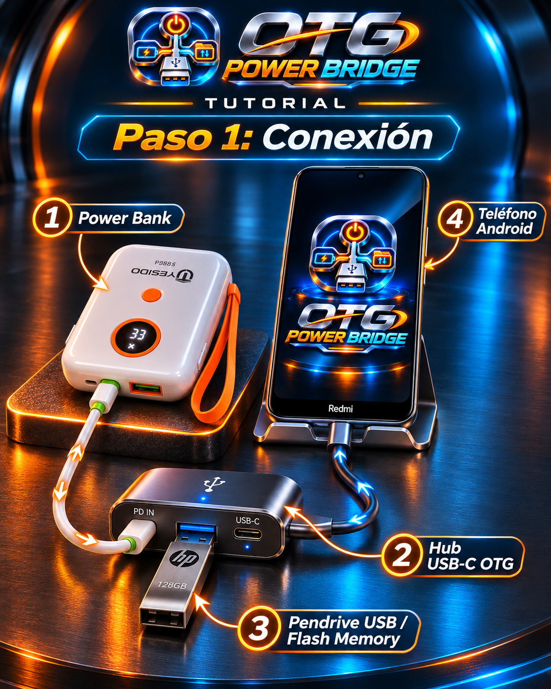

<div align="center">


# OTG POWER BRIDGE

### Conecta · Alimenta · Transfiere

**Aplicación Android creada por GENAI INDUSTRIES**  
**Creador y director:** Luis Carlos Moreno Jiménez — Santa Cruz de la Sierra, Bolivia.

**Estado:** v0.6.3 publicada en Releases; archivo verificado estáticamente. La aceptación de interfaz/hardware y las capturas reales siguen pendientes de evidencia en esta revisión.

</div>

<!-- repo-monitor:start -->
## v0.6.3 publicada · aceptación incompleta

[Release v0.6.3](https://github.com/luis171987/OTG-POWER-BRIDGE/releases/tag/v0.6.3), publicada el **2026-11-05 UTC**. Tag y fuente exacta: [`6a8ac407169aa0d7cfa4ff1c1dc5df5544542718`](https://github.com/luis171987/OTG-POWER-BRIDGE/commit/6a8ac407169aa0d7cfa4ff1c1dc5df5544542718).

| Plataforma | Archivo publicado | Requisitos definidos | Verificación |
| --- | --- | --- | --- |
| Android | [OTG-POWER-BRIDGE.apk · v0.6.3](https://github.com/luis171987/OTG-POWER-BRIDGE/releases/download/v0.6.3/OTG-POWER-BRIDGE.apk) | Android 8.0+; capacidades del teléfono/hub sujetas a prueba | 7.304.400 bytes, hash y firma v2 comprobados estáticamente; aceptación de uso pendiente |

- [CI del tag, ejecución 42128808304, intento 1](https://github.com/luis171987/OTG-POWER-BRIDGE/actions/runs/42128808304): **aprobado** para 37+10 condiciones estáticas, `:app:assembleDebug`, `:app:assembleRelease` e integridad ZIP. El CI entrega la variante release **sin firma**; ese artefacto no se ofrece como instalador.
- El APK de Releases tiene firma v2 criptográficamente válida y los mismos 120 archivos ajenos a la firma que el APK release del [CI de cd8b3773](https://github.com/luis171987/OTG-POWER-BRIDGE/actions/runs/42123871904), cuyo árbol fuente coincide con el tag. Esto acredita la relación estática del archivo con la fuente; no certifica el funcionamiento en Android ni la continuidad de la clave del propietario.
- **Puertas pendientes de evidencia:** las ocho comprobaciones Kotlin no se ejecutan en el workflow; no hay resultados de interfaz ni capturas reales del SHA publicado. El propietario declara pruebas físicas en la documentación de release; esta revisión no las ejecutó ni dispone de un registro reproducible por versión/dispositivo.
- **Galería:** las cinco imágenes actuales son conceptos de diseño. No se presentan como capturas de v0.6.3; las tomas reales siguen pendientes.
- El hash completo, huella del certificado, procedencia, límites y todos los enlaces de archivos están en la [ficha de entrega](docs/versiones/2026-11-05_v0.6.3/README.md) y el [manifiesto](docs/versiones/2026-11-05_v0.6.3/archivos.json). Se conserva el [índice histórico](docs/versiones/README.md), incluida la preview 0.5.0.

La publicación en Releases no sustituye la [validación física y funcional documentada](docs/MODO_REAL_ANDROID.md#compatibilidad-y-límites-físicos).
<!-- repo-monitor:end -->

<!-- OTG:CYBER_COCKPIT_V06:START -->
## 🚀 Cyber Cockpit V0.6.0

**Referencia visual:** conceptos de diseño V0.6.0; la entrega publicada es v0.6.3. Consulta arriba el build comprobado y las puertas de aceptación pendientes.
 — Cinco pantallas aprobadas

La nueva versión de **OTG POWER BRIDGE** reorganiza la interfaz Android en **cinco pantallas realmente navegables**, conservando el logotipo 3D oficial y un estilo oscuro metalizado, cian y naranja. El encabezado panorámico se adapta de la imagen oficial; las tarjetas y botones son elementos **Jetpack Compose funcionales**, no fotografías con áreas táctiles ficticias.

**Las siguientes imágenes son conceptos de diseño aprobados**, no capturas de la V0.6.0 instalada. Los porcentajes, vatios, marcas, capacidades, transferencias y registros que aparezcan dibujados en ellas son **ejemplos ilustrativos**, nunca resultados de mediciones. La aplicación muestra valores reales cuando Android los proporciona, y «No disponible» en caso contrario.

### 1. Tablero · Cyber Cockpit


**Al tocar Tablero:** muestra el estado real de batería y alimentación, señales USB/OTG accesibles, conexión a carpeta SAF, estado de transferencia y acceso rápido al diagnóstico. **Conectar** solicita elegir una carpeta en Android. **Desconectar** cierra la sesión de la aplicación, sin cortar físicamente la corriente.

### 2. Transferir · Gestor de copias


**Al tocar Transferir:** se elige una carpeta de destino, se autoriza escritura y se selecciona un archivo origen. El motor copia **datos reales**, muestra bytes y porcentaje cuando el tamaño es conocido y comprueba **SHA-256** al finalizar. La pausa y las colas de varios archivos dibujadas en el concepto **todavía no están implementadas**; se opera un archivo a la vez.

### 3. Memoria · Explorador


**Al tocar Memoria:** muestra capacidad de la partición de datos del teléfono, y volumen externo si Android permite medirlo. Permite explorar carpetas autorizadas, editar textos creando una copia nueva, duplicar con hash, renombrar y eliminar **solo después de respaldo y confirmación**. Un volumen extraíble puede ser USB o microSD.

### 4. Herramientas · Diagnóstico


**Al tocar Herramientas:** consulta la batería, USB host, dispositivos visibles y permisos de la carpeta seleccionada; permite recalcular diagnósticos y obtener el SHA-256 de un archivo real. No afirma medir watts, hacer expulsión física por software ni ejecutar pruebas eléctricas sin instrumentación compatible.

### 5. Ajustes · Configuración


**Al tocar Ajustes:** cambia los efectos de flujo, el espaciado y la visualización de identificadores técnicos. Estos ajustes se guardan en las preferencias privadas de la aplicación. La verificación de copias no puede desactivarse accidentalmente.

📘 **[Mapa funcional, límites físicos y pruebas pendientes](docs/FRONTEND_CYBER_COCKPIT_V06.md)**
<!-- OTG:CYBER_COCKPIT_V06:END -->

<!-- OTG:APK:START -->
## 📲 Descargar e instalar OTG POWER BRIDGE en Android

**Aplicación creada por GENAI INDUSTRIES** · Compatible a nivel de diseño con teléfonos Android de múltiples marcas (Samsung, HONOR, Redmi/Xiaomi, Motorola y otras), sujeto a las capacidades reales del hardware.

### 📦 APK v0.6.3 publicado · validación de uso incompleta

**El archivo APK existe en GitHub Releases v0.6.3.** Su hash y firma v2 se comprobaron estáticamente; esto no acredita pruebas de funcionamiento, compatibilidad física ni capturas de la interfaz.

**[📦 Consultar descargas y versiones disponibles](https://github.com/luis171987/OTG-POWER-BRIDGE/releases)**

[Descargar el archivo publicado OTG-POWER-BRIDGE.apk de v0.6.3](https://github.com/luis171987/OTG-POWER-BRIDGE/releases/download/v0.6.3/OTG-POWER-BRIDGE.apk). Consulta la ficha de entrega antes de instalar; esta revisión no ha instalado ni ejecutado el APK.

### Instalación en el teléfono

1. Abre el enlace de descarga en tu navegador Android.
2. Cuando haya un APK publicado, toca **Descargar** y ábrelo desde **Descargas**.
3. Si Android lo solicita, autoriza temporalmente **Instalar aplicaciones desconocidas** solo para el navegador o gestor de archivos que hayas elegido. No desactives Play Protect.
4. Comprueba el nombre del archivo, su origen GitHub y la firma del instalador cuando estén disponibles; instala únicamente versiones verificadas.
5. Abre **OTG POWER BRIDGE**, conecta un **hub USB compatible con datos y carga pasante**, y concede acceso a las carpetas que desees gestionar mediante el selector de Android.

> ⚠️ **Importante:** la app no convierte un power bank en un hub USB. Que el teléfono pueda cargar y usar memoria OTG al mismo tiempo depende de sus características eléctricas, del hub y de la negociación USB. Android 8+ es el mínimo de proyecto, no una garantía de compatibilidad universal.

**[📖 Ver tutorial ilustrado de conexión y transferencia](#-tutorial-de-conexión-física)** · **[🧩 Consultar código fuente](https://github.com/luis171987/OTG-POWER-BRIDGE)**

> 📥 **Archivo publicado v0.6.3:** [APK de esta entrega](https://github.com/luis171987/OTG-POWER-BRIDGE/releases/download/v0.6.3/OTG-POWER-BRIDGE.apk). Consulta su verificación estática y limitaciones en la [ficha de versión](docs/versiones/2026-11-05_v0.6.3/README.md).

<!-- OTG:APK:END -->

<!-- OTG:REAL:START -->
## 🔌 Panel Android real · Conectar / Desconectar · v0.5.0

**Sin modo sandbox ni simulador.** Este código consulta Android y trabaja únicamente con carpetas y archivos reales que autorice cada usuario.

**Conectar** abre el selector de carpetas de Android y activa una sesión de acceso real cuando la carpeta está disponible. **Desconectar** termina el acceso de la aplicación; no desconecta físicamente el hardware. Los indicadores de **batería, carga, USB / OTG, carpeta y volumen extraíble** muestran observaciones del dispositivo, no valores inventados.

Las imágenes anteriores V0.4/V0.5 se retiraron del README y fueron sustituidas por las cinco pantallas de Cyber Cockpit V0.6.0; los renders de V0.6 son **propuestas de diseño**, no capturas de una ejecución real. La app no confirma "hub conectado" únicamente porque se abra una carpeta interna: indica por separado los dispositivos observables, el origen del almacenamiento y la alimentación.

**Transferencia efectiva:** seleccionar una carpeta USB/SD a través de Android → autorizar escritura → seleccionar un archivo origen → copiar con verificación SHA-256 sin borrar el original. Ver [protocolo de prueba real](docs/MODO_REAL_ANDROID.md).

⚠️ La app **no activa físicamente USB-PD, OTG ni compatibilidad inexistente**. La carga simultánea y los datos dependen del hardware, el hub y el teléfono. En Android 11+ algunas carpetas raíz no se pueden seleccionar; utiliza una subcarpeta autorizable.
<!-- OTG:REAL:END -->

## 📊 Panel de telemetría real V0.5.0

El panel distingue **batería del teléfono** (porcentaje real comunicado por Android), **power bank** (porcentaje no disponible cuando no existe protocolo de telemetría), **dispositivos USB** (fabricante/producto/VID/PID si Android los expone), **volumen de almacenamiento** (etiqueta, capacidad total, libre y usado cuando sea medible) y **progreso de transferencia** (nombre del archivo, bytes, porcentaje cuando el tamaño existe, SHA-256 final).

**No inventa capacidades:** una memoria USB-C o USB-A puede aparecer como volumen SAF sin identificarse por fabricante; un microSD también puede figurar como extraíble. Si el almacenamiento o el power bank no reportan alguna métrica se indicará **No disponible** en lugar de presentar un valor simulado. El tipo de conector físico no puede inferirse por una API universal.

El botón **Conectar** permite seleccionar una carpeta mediante Android. El botón **Desconectar** termina la sesión de acceso de la app, no desconecta físicamente el hub. Para transferir, autoriza escritura y utiliza una copia de prueba. Los archivos originales se conservan durante la copia; el éxito se informa solo tras comparar SHA-256.

**Base de telemetría:** incorporada desde `0.5.0`; la entrega publicada actual es `0.6.3`, con su evidencia y límites en la ficha enlazada arriba. Consultar [documentación técnica de telemetría](docs/TELEMETRIA_REAL_V0_5_0.md).

## 📢 Comparte el repositorio en WhatsApp y Facebook


**Repositorio público previsto:** [github.com/luis171987/OTG-POWER-BRIDGE](https://github.com/luis171987/OTG-POWER-BRIDGE) (el enlace funcionará después del primer `push`).

Para que este **logo aparezca como miniatura cuando se comparta el enlace**, el propietario debe cargar la imagen anterior en **GitHub → Settings → Social preview → Edit → Upload an image**. Este paso se realiza **una sola vez** tras crear el repositorio y **no puede sustituirse por poner una imagen en el README**. Consulta las [instrucciones de vista previa para WhatsApp y Facebook](docs/COMPARTIR_WHATSAPP_FACEBOOK.md). Las redes pueden conservar miniaturas en caché.

## ¿Para qué sirve?

**OTG POWER BRIDGE** ayuda a consultar la carga del teléfono, detectar dispositivos USB visibles y administrar archivos de carpetas autorizadas por el usuario. Su objetivo es facilitar transferencias cuando necesitas usar una memoria USB **mientras alimentas tu teléfono desde un power bank**, siempre que un **hub OTG con alimentación pasante** y tu Android permitan ambas funciones simultáneamente.

La app **no puede crear una ruta USB de datos por software** ni hacer compatible un dispositivo que físicamente no admite carga + OTG. La alimentación es un circuito físico; los archivos viajan por el hub y el bus USB, no por la app ni a través del power bank.

## 🎬 Caso de uso: trabajando con el teléfono y la batería casi agotada

> Imagina que estás trabajando desde el celular. Tienes fotografías, un contrato PDF y documentos que debes entregar en una memoria USB. El teléfono marca **8 % de batería** y no puedes esperar a que se recargue para terminar la transferencia. Necesitas conectar un power bank **sin desconectar el pendrive**.

**Solución propuesta:** un hub USB-C compatible con **entrada de carga PD** y **puerto USB de datos** permite conectar una batería externa y una memoria al teléfono por un solo conector USB-C. En modelos Android que admitan el funcionamiento simultáneo, OTG POWER BRIDGE ayuda a seleccionar la carpeta de destino y copiar archivos verificando su integridad.

### Imagen 1 — Ejemplo completo de la solución


*Se distinguen **dos rutas independientes**: el **cable de alimentación** conecta el power bank a la entrada **PD IN** del hub; el **pendrive** se conecta a un **puerto USB DATA** del hub; el hub se conecta al teléfono. Imagen conceptual, no prueba de compatibilidad ni fotografía de equipos en funcionamiento.*

## 🔌 Tutorial de conexión física

### Imagen 2 — Identifica cada dispositivo y conéctalo



**Paso 1 — Prepara el teléfono.** Comprueba que dispone de puerto USB compatible con OTG. Abre la app sin conectar todavía la memoria y comprueba el estado de la batería. No todas las marcas admiten carga y datos OTG simultáneos.

**Paso 2 — Conecta el hub.** Inserta el conector principal del **hub USB-C OTG** en el teléfono. El hub debe anunciar **USB data / OTG** y, por separado, **PD IN / carga pasante**. Un divisor de carga o un adaptador exclusivamente eléctrico no sirve como sustituto de un hub de datos.

**Paso 3 — Conecta el pendrive al puerto de datos.** Utiliza USB-A o USB-C según la memoria. Una memoria **micro-USB** necesita un adaptador USB de datos compatible. **No conectes la memoria a PD IN.** Si Android muestra la unidad en el selector de archivos, habrá una vía de datos accesible.

**Paso 4 — Conecta el power bank a PD IN.** Utiliza la salida USB-C del power bank, un cable apropiado y la entrada de alimentación PD del hub. Deben ser eléctricamente compatibles. **No empalmes cables ni conectes el SUNSHINE SS-905D de reparación.** Confirma que Android indica alimentación externa y comprueba si el pendrive sigue accesible.

**Prueba de compatibilidad necesaria:** primero verifica acceso USB sin alimentación; luego conecta energía, observa que el teléfono realmente cargue y vuelve a comprobar el almacenamiento. Si cualquiera de las funciones deja de funcionar, esa combinación **no está validada**.

## 📱 Tutorial dentro de la aplicación

### Imagen 3 — Detectar, autorizar y transferir


**1. Consultar energía:** abre OTG POWER BRIDGE y comprueba el estado de batería que informa Android. La app **no mide directamente voltios, amperios, potencia PD ni capacidad del power bank**. Los valores eléctricos ilustrados en los renders son solo ejemplos visuales.

**2. Comprobar memoria:** pulsa **Actualizar diagnóstico USB**. La enumeración USB puede ser incompleta; la prueba definitiva de accesibilidad de archivos es que Android ofrezca la unidad en el selector de documentos.

**3. Autorizar carpeta:** pulsa **Conectar** y elige una carpeta del pendrive desde el selector de Android. Si el dispositivo no aparece, no atribuyas el fallo a la app sin revisar el hub, la alimentación y el formato del almacenamiento.

**4. Transferir un archivo del teléfono:** habilita los cambios de archivos; pulsa **Copiar archivo a carpeta · SHA-256**, selecciona el PDF, documento o fotografía mediante el selector de Android y espera la confirmación de la copia. El original permanece intacto y el contenido transferido se compara mediante **SHA-256**, según lo implementado en el código. **El código 0.4.0 debe compilarse y validarse con archivos de prueba en un teléfono real.**

**5. Expulsión:** al terminar, comprueba que la operación terminó antes de retirar el pendrive. Utiliza la opción de expulsión del sistema Android si está disponible. Desconectar la memoria durante una escritura puede corromper archivos.

## 🧭 Vista previa del frontend Android

### Imagen 4 — Panel principal del producto


*Diseño visual del frontend; no es una captura de una aplicación instalada. La interfaz implementada en el prototipo es más sencilla. Los módulos ilustrados que todavía no existen no deben interpretarse como funciones terminadas.*

| Panel | Función | Estado del prototipo |
| --- | --- | --- |
| **Energía** | Consultar porcentaje y estado de carga reportados por Android | Implementación inicial |
| **Diagnóstico USB** | Consultar USB host, dispositivos enumerados y VID/PID cuando Android los expone | Implementación inicial |
| **Explorar** | Navegar en carpetas autorizadas mediante Storage Access Framework (SAF) | Implementación inicial |
| **Copiar a USB** | Seleccionar archivo del sistema y copiarlo a carpeta autorizada con verificación SHA-256 | Código incorporado en v0.3.0; pendiente de probar en dispositivo |
| **Editar** | Abrir textos UTF-8 pequeños y guardar una copia nueva sin sobrescribir el original | Implementación inicial |
| **Respaldo** | Duplicar archivos con SHA-256 en la carpeta autorizada | Implementación inicial |
| **Seguridad** | Cambios desactivados por defecto y confirmación de operaciones destructivas | Implementación inicial |
| **Sincronizar automáticamente** | Sincronización bidireccional o programada | **No implementado** |

## 🌍 Compatibilidad universal por capacidades

Compatible **a nivel de diseño** con múltiples fabricantes Android (HONOR, Samsung, Redmi/Xiaomi, Motorola, Pixel y otros), hubs USB-C con funciones adecuadas, power banks de diversas marcas y pendrives **USB-A, USB-C o micro-USB mediante adaptador USB de datos**.

- **Android 8.0 o superior** es el mínimo definido por este proyecto (`minSdk 26`), **no** una certificación de funcionamiento en todos los teléfonos de esa versión.
- No existe garantía universal de carga simultánea + OTG: depende del firmware, el hardware USB del teléfono, el hub, la negociación de alimentación y los adaptadores.
- No se requiere root, ADB ni Termux para usar la app una vez compilada e instalada.
- La copia entre teléfono y USB requiere acceso concedido al archivo de origen y a la carpeta de destino, además de permisos efectivos de escritura del proveedor de documentos.
- Android puede exponer memorias USB desde el selector de archivos aunque no muestre el periférico en la lista de dispositivos USB accesible a la aplicación.

## 🔐 Privacidad y seguridad

Los archivos seleccionados se procesan en el dispositivo mediante permisos del sistema Android; no se necesita subir documentos a un servidor. Las operaciones que modifican archivos están desactivadas inicialmente. **La copia de respaldo dentro del mismo pendrive no sustituye un respaldo en otro almacenamiento.** No se recomienda utilizar documentos únicos e irremplazables antes de completar pruebas físicas y de software.

## 📦 Instalación y APK

**Hay un APK publicado en Releases v0.6.3.** Se verificaron estáticamente su tamaño, SHA-256, firma v2 y correspondencia de contenido con CI. La ejecución en Android, la compatibilidad física y las capturas reales no quedan acreditadas por esas comprobaciones. No use las imágenes conceptuales como prueba de funcionamiento.

Para compilar desde un entorno Android con Java, Android SDK API 35 y Gradle:

```bash
bash scripts/build_termux.sh
```

El script registra diagnósticos y no instala automáticamente el APK. Consulta [`README_BUILD_ES.md`](README_BUILD_ES.md).

## 🧪 Estado de pruebas

Se han ejecutado pruebas **lógicas/simuladas** en versiones anteriores; la versión `0.3.0-preview` incorpora cambios de marca y transferencia SAF. **No se ha compilado ni probado en hardware real en esta sesión.** Las imágenes son renders conceptuales. Las cifras y los estados ficticios mostrados en ellas son únicamente ilustrativos.

## Créditos

**OTG POWER BRIDGE** — Aplicación creada por **GENAI INDUSTRIES**.  
**Dirección y autoría:** Luis Carlos Moreno Jiménez, Santa Cruz de la Sierra, Bolivia.  
Logo 3D: **versión oficial aprobada por su autor**. La marca y sus recursos visuales no se deben sustituir por versiones de prueba.

**Referencias técnicas:** [Android — Storage Access Framework](https://developer.android.com/training/data-storage/shared/documents-files), [Android — USB host](https://developer.android.com/develop/connectivity/usb/host), [GitHub — vínculos de descarga de releases](https://docs.github.com/en/repositories/releasing-projects-on-github/linking-to-releases).
