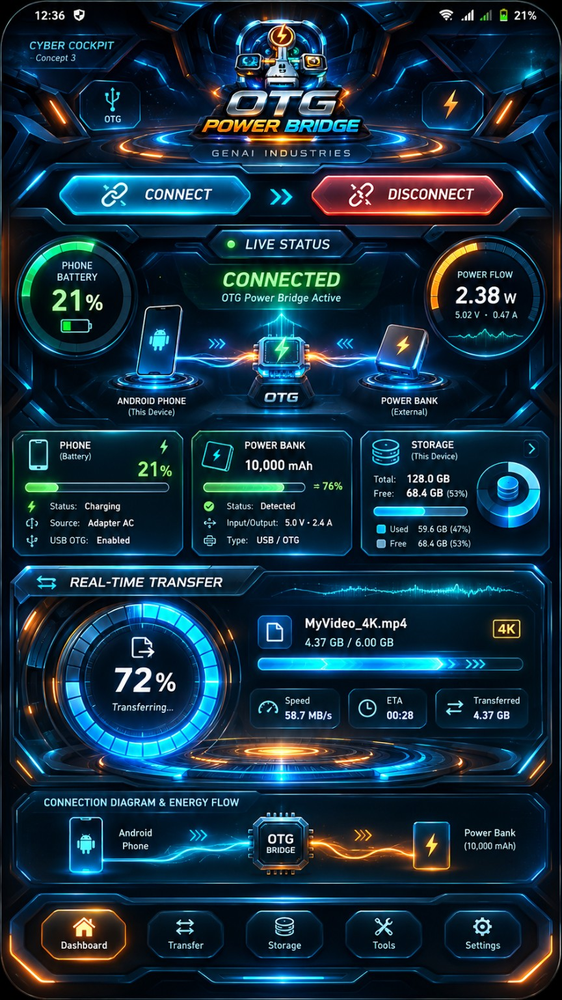
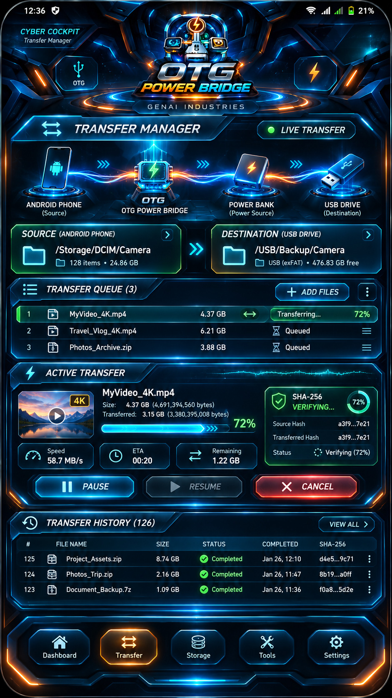
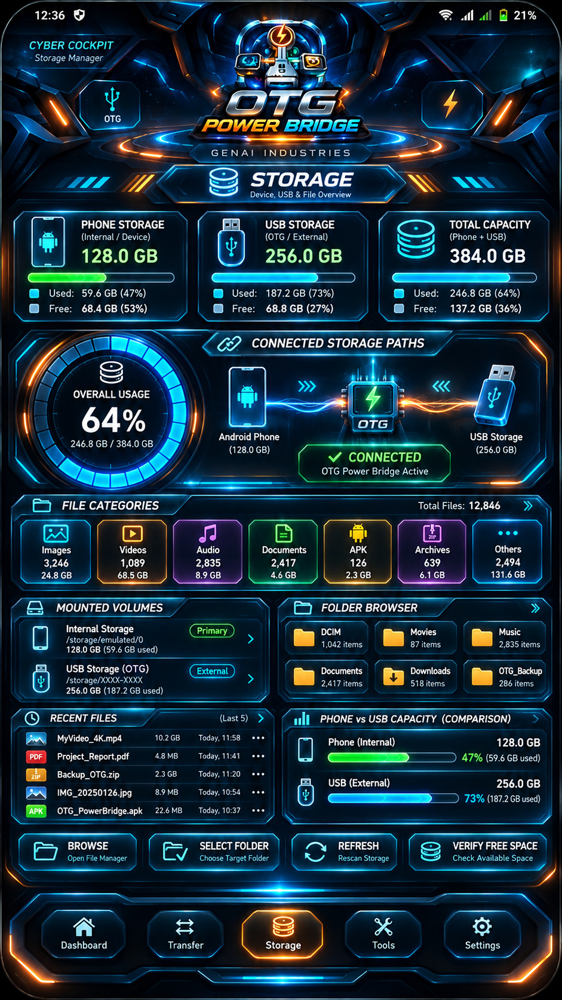
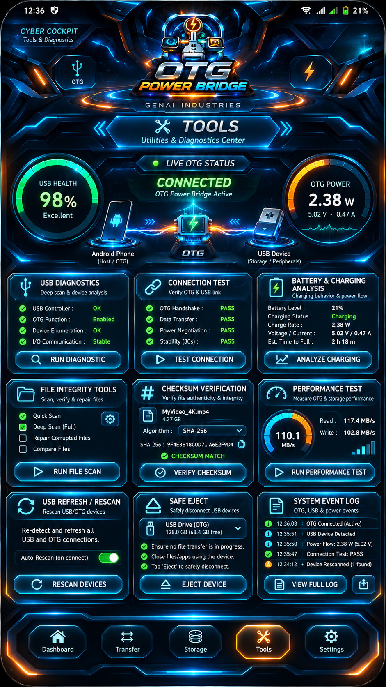
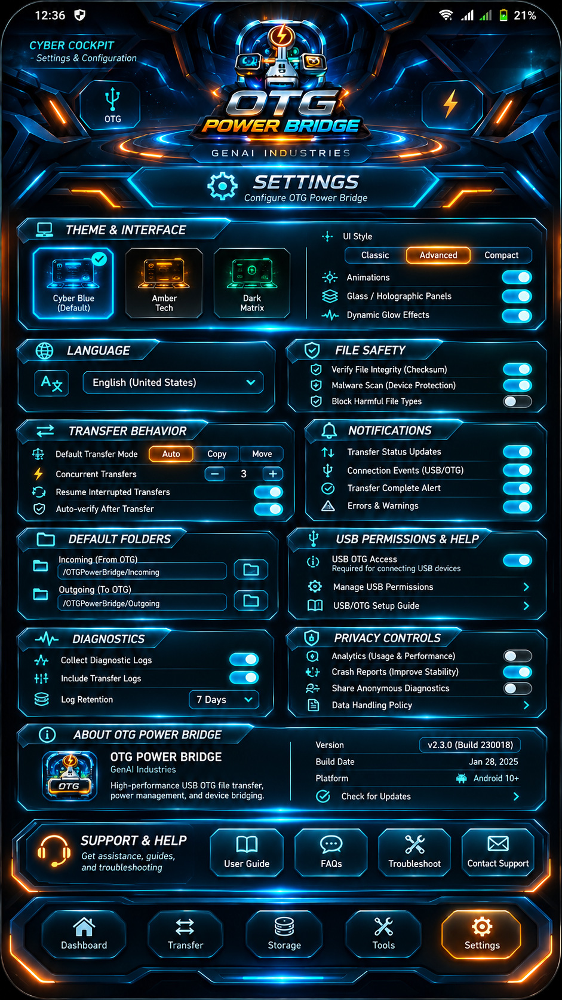

<div align="center">


# ⚡ OTG POWER BRIDGE

### CYBER COCKPIT 3D · ANDROID · VERSIÓN ESTABLE **0.6.3**

**Energía · Conectividad USB/OTG · Transferencia de archivos**

**GENAI INDUSTRIES** · Autor: **Luis Carlos Moreno Jiménez** · Santa Cruz de la Sierra, Bolivia 🇧🇴

[](https://github.com/luis171987/OTG-POWER-BRIDGE/releases/tag/v0.6.3)
[](https://github.com/luis171987/OTG-POWER-BRIDGE/releases/latest)

</div>

## 🎬 VIDEO OFICIAL — OTG POWER BRIDGE V0.6.3 (1 min 42 s)

**¿Estás viajando, la batería se está agotando y necesitás copiar archivos de una memoria USB?** Mirá primero esta demostración con narración femenina en español latinoamericano. Muestra el **HVE / hub OTG**, el **power bank** conectado a la entrada de alimentación del hub y las **memorias USB** conectadas a sus puertos; después presenta las cinco pantallas Cyber Cockpit.

<div align="center">

[](assets/videos/OTG_POWER_BRIDGE_V063_COMERCIAL_ESMX_102S.mp4)

<video src="https://github.com/luis171987/OTG-POWER-BRIDGE/raw/refs/heads/main/assets/videos/OTG_POWER_BRIDGE_V063_COMERCIAL_ESMX_102S.mp4" controls playsinline preload="metadata" poster="assets/ui_aprobada/00_tablero_cyber_cockpit_aprobado.jpg">
  <a href="https://github.com/luis171987/OTG-POWER-BRIDGE/raw/refs/heads/main/assets/videos/OTG_POWER_BRIDGE_V063_COMERCIAL_ESMX_102S.mp4">▶️ Reproducir el video oficial (MP4, con sonido)</a>
</video>

### ▶️ [REPRODUCIR / DESCARGAR EL VIDEO OFICIAL CON SONIDO](https://github.com/luis171987/OTG-POWER-BRIDGE/raw/refs/heads/main/assets/videos/OTG_POWER_BRIDGE_V063_COMERCIAL_ESMX_102S.mp4)

<sub>Video promocional de 102 segundos · 720 × 1280 · voz femenina es-MX · archivo MP4 almacenado en este repositorio.</sub>

</div>

> 🔊 **Para escuchar la narración, tocá Reproducir.** Por las restricciones de GitHub y de los navegadores, el README no puede imponer reproducción automática **con sonido**. El enlace de video funciona como alternativa cuando el reproductor integrado no está disponible.
>
> ⚠️ **Demostración promocional:** la carga simultánea con OTG solo funciona si tanto el teléfono como el HVE / hub USB-C con entrada PD son compatibles. La aplicación **no activa ni garantiza** esa capacidad física.

## 📥 [⬇️ DESCARGAR LA ÚLTIMA APK OFICIAL](https://github.com/luis171987/OTG-POWER-BRIDGE/releases/latest/download/OTG-POWER-BRIDGE.apk)

**[📦 Ver versión publicada y notas](https://github.com/luis171987/OTG-POWER-BRIDGE/releases/tag/v0.6.3)** · **[📖 Instalación y uso](#-instalación-en-android)**


> ✅ **VERSIÓN ACTUAL: V0.6.3**. Este README describe únicamente la versión estable publicada. Los prototipos anteriores se conservan en el historial de Git y la documentación técnica, **pero no son la descarga recomendada**.

## 🚀 ¿Qué es OTG POWER BRIDGE?

Una aplicación **nativa de Android (Kotlin / Jetpack Compose)** para visualizar información real de batería y USB, abrir carpetas autorizadas por Android, gestionar archivos y realizar copias verificadas mediante **SHA-256**. Su interfaz **Cyber Cockpit 3D** distribuye las herramientas en cinco paneles.

No hace falta root ni Termux para utilizar el APK instalado. **No crea funciones eléctricas inexistentes**: usar una memoria OTG mientras se carga el móvil solo es posible si el **teléfono y el hub USB-C con entrada de alimentación PD** lo permiten.

## 🔵 Cinco pantallas Cyber Cockpit — Versión 0.6.3

Los cinco diseños siguientes son **referencias gráficas de la interfaz aprobada**. Están enlazados a su imagen original para verlos con más nitidez. La app instalada contiene controles funcionales y datos de Android; los números que se vean en los diseños son ilustrativos, **no telemetría real ni capturas certificadas**.

### 1. Tablero

<a href="assets/ui_aprobada/00_tablero_cyber_cockpit_aprobado.jpg"></a>

[🔍 Abrir imagen original a máxima resolución disponible](assets/ui_aprobada/00_tablero_cyber_cockpit_aprobado.jpg)

### 2. Transferencias

<a href="assets/ui_aprobada/01_transferencias.jpg"></a>

[🔍 Abrir imagen original a máxima resolución disponible](assets/ui_aprobada/01_transferencias.jpg)

### 3. Memoria

<a href="assets/ui_aprobada/02_almacenamiento.jpg"></a>

[🔍 Abrir imagen original a máxima resolución disponible](assets/ui_aprobada/02_almacenamiento.jpg)

### 4. Herramientas

<a href="assets/ui_aprobada/03_herramientas.jpg"></a>

[🔍 Abrir imagen original a máxima resolución disponible](assets/ui_aprobada/03_herramientas.jpg)

### 5. Ajustes

<a href="assets/ui_aprobada/04_ajustes.jpg"></a>

[🔍 Abrir imagen original a máxima resolución disponible](assets/ui_aprobada/04_ajustes.jpg)
## 🧭 Funciones de cada pantalla

| Pantalla | Qué ofrece |
|:--|:--|
| **Tablero** | Batería y estado de carga reales, estado USB/OTG accesible, conexión autorizada y resumen de transferencias. |
| **Transferencias** | Seleccionar archivos y destinos autorizados, copiar y comprobar su integridad con SHA-256; progreso real cuando existe una operación. |
| **Memoria** | Mostrar capacidad ocupada y libre disponible a través de Android, explorar carpetas autorizadas y operaciones documentales. |
| **Herramientas** | Diagnóstico USB/Host, identificación de dispositivos cuando se expone y comprobación SHA-256. |
| **Ajustes** | Preferencias de visualización, información y controles de seguridad. |

## 🔌 Conectar teléfono, power bank y memoria USB

**Necesitás:** teléfono Android con capacidades OTG compatibles, **hub USB-C con puertos de datos y entrada PD IN**, un pendrive USB-A/USB-C (o adaptador de datos apropiado) y una fuente de energía compatible.

1. Enchufá el **hub USB-C/OTG** al teléfono.
2. Conectá la **memoria USB** a un puerto **USB DATA** del hub.
3. Conectá el **power bank** a **PD IN** del hub, **si es compatible**.
4. Abrí **OTG POWER BRIDGE**, verificá batería, carga y dispositivos visibles.
5. En **Conectar**, autorizá una carpeta mediante el selector de Android (**SAF**).
6. Seleccioná el archivo y la carpeta de destino; ejecutá la copia y comprobá el resultado **SHA-256**.
7. Al terminar, verificá el fin de la escritura antes de retirar la memoria. **Desconectar** cierra la sesión de la app, no expulsa físicamente el dispositivo.

> ⚠️ **Compatibilidad:** USB Host no garantiza carga + OTG simultáneos. Android puede mostrar memorias en SAF sin enumerarlas en USB. El porcentaje del **power bank** y la potencia eléctrica se muestran como **no disponibles** si el hardware no ofrece telemetría. Usar un hub con varios puertos no garantiza que Android reconozca todas las unidades.

## 📲 Instalación en Android

**[➡️ DESCARGAR OTG-POWER-BRIDGE.apk — VERSIÓN ESTABLE](https://github.com/luis171987/OTG-POWER-BRIDGE/releases/latest/download/OTG-POWER-BRIDGE.apk)**

1. Abrí el enlace oficial anterior desde el teléfono.
2. Descargá **`OTG-POWER-BRIDGE.apk`**; es el instalador, **no** el archivo «Source code ZIP».
3. Abrilo con el gestor de archivos y autorizá la instalación desde esa aplicación únicamente si Android lo solicita.
4. No desactives Play Protect. Si una versión de prueba antigua tiene firma diferente, respaldá sus datos antes de desinstalarla.
5. Conectá los accesorios compatibles y concedé los permisos de acceso a archivos que necesites.

**Datos del APK oficial V0.6.3:** paquete `bo.genai.usbpowerbridge` · `versionCode 10` · Android mínimo definido por el proyecto: **8.0 (API 26)**.

**SHA-256 del APK publicado** (verificado en el lanzamiento):

```text
2fce8d4def837e4b0734c4a72f4d768b3de1451f5453fd2860a3a75a50a67aab
```

## 🛡️ Privacidad y precisión

- Los archivos se gestionan mediante permisos **SAF** del sistema; no es necesario enviarlos a un servidor para copiar entre carpetas autorizadas.
- Los indicadores muestran información disponible en Android. Si un dato no está accesible, la interfaz debe decirlo expresamente.
- La función de carga depende del hardware compatible; la app **no activa físicamente USB-PD** y **supervisa, no controla físicamente la alimentación**. La [verificación estática de v0.6.3](docs/versiones/2026-11-05_v0.6.3/README.md) no acredita por sí sola aceptación funcional ni física.
- **No se requiere root** para las funciones normales de la aplicación.

## 📚 Documentación e historial técnico

- [Lanzamiento estable V0.6.3](https://github.com/luis171987/OTG-POWER-BRIDGE/releases/tag/v0.6.3).
- [Ver todas las versiones publicadas](https://github.com/luis171987/OTG-POWER-BRIDGE/releases).
- [Tutorial de conexión física](docs/MODO_REAL_ANDROID.md).
- [Historial y auditorías del proyecto](docs/versiones/README.md) (si está disponible).

Los diseños y documentos antiguos siguen formando parte del **historial técnico del repositorio**; no se muestran como una versión actualmente instalable en esta portada.

## 📢 Compartir en Facebook y WhatsApp

**[🔗 Compartir el repositorio oficial](https://github.com/luis171987/OTG-POWER-BRIDGE)**

Para cambiar la miniatura del enlace se debe actualizar **GitHub → Settings → Social preview** con la portada Cyber Cockpit aprobada. El README y su primera imagen **no modifican automáticamente** esa miniatura. Facebook y WhatsApp pueden conservar imágenes anteriores en caché.

---

**OTG POWER BRIDGE © GENAI INDUSTRIES** · Creado por **Luis Carlos Moreno Jiménez** · Santa Cruz de la Sierra, Bolivia 🇧🇴
